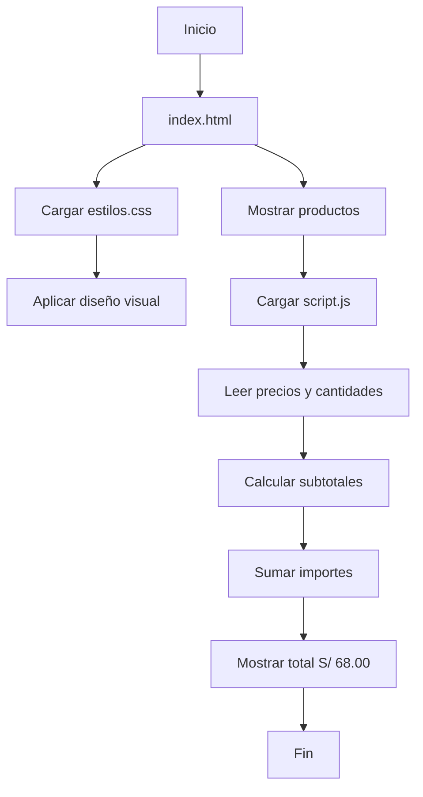

# 🛒 Tienda TECSUP


## 📌 Descripción

Tienda TECSUP es una aplicación web desarrollada como proyecto académico para representar una pequeña tienda de productos institucionales. Permite visualizar productos, consultar sus precios y cantidades, y calcular automáticamente el importe total de la compra.

Está dirigida a estudiantes y usuarios interesados en conocer un ejemplo práctico de desarrollo web utilizando tecnologías frontend básicas.

## 📑 Tabla de contenidos

- [Características](#-características)
- [Tecnologías utilizadas](#-tecnologías-utilizadas)
- [Estructura del proyecto](#-estructura-del-proyecto)
- [Instalación](#-instalación)
- [Uso](#-uso)
- [Productos y resultados](#-productos-y-resultados)
- [Funcionamiento](#-funcionamiento)
- [Arquitectura](#-arquitectura)
- [Hoja de ruta](#-hoja-de-ruta)
- [Contribución](#-contribución)
- [Licencia](#-licencia)

## ✨ Características

- Visualización de productos y precios.
- Presentación de cantidades en una tabla.
- Cálculo automático del total de la compra.
- Diseño visual con colores institucionales de TECSUP.
- Separación del contenido HTML, los estilos CSS y la lógica JavaScript.
- Código organizado para facilitar futuras mejoras.

## 💻 Tecnologías utilizadas

| Tecnología | Aplicación |
|:---|:---|
| HTML5 | Estructura de la página web |
| CSS3 | Diseño y presentación visual |
| JavaScript | Cálculo del importe total |
| Git | Control de versiones |
| GitHub | Almacenamiento y publicación del proyecto |

## 📁 Estructura del proyecto

```text
tienda-tecsup/
├── index.html
├── estilos.css
├── script.js
├── README.md
├── CONTRIBUTING.md
└── LICENSE
```

## ⚙️ Instalación

No es necesario instalar programas adicionales para ejecutar la aplicación.

1. Clonar el repositorio:

```bash
git clone https://github.com/alamaronald-maker/tienda-tecsup.git
```

2. Ingresar a la carpeta del proyecto:

```bash
cd tienda-tecsup
```

3. Abrir el archivo `index.html` en un navegador web.

## 🚀 Uso

1. Abrir el archivo `index.html` en el navegador.
2. Visualizar los productos disponibles.
3. Consultar los precios y las cantidades.
4. Revisar el importe total calculado automáticamente.

Ejemplo de la función JavaScript utilizada para calcular el importe:

```javascript
function calcularTotal(lista) {
    let total = 0;

    for (const producto of lista) {
        total += producto.precio * producto.cantidad;
    }

    return total;
}
```

## 📊 Productos y resultados

La siguiente tabla presenta los productos utilizados como ejemplo en la aplicación:

| Producto | Precio unitario | Cantidad | Subtotal |
|:---|---:|---:|---:|
| Polo TECSUP | S/ 25.00 | 2 | S/ 50.00 |
| Taza TECSUP | S/ 18.00 | 1 | S/ 18.00 |
| **Total** | | **3** | **S/ 68.00** |

**Resultado esperado: Total S/ 68.00**

## 🔄 Funcionamiento

La aplicación utiliza JavaScript para procesar la información de los productos. La función `calcularTotal()` recorre la lista, multiplica el precio unitario por la cantidad de cada producto y acumula los subtotales.

Finalmente, el importe total se muestra en la página mediante la manipulación del contenido HTML.

## 🧩 Arquitectura

El proyecto está organizado en tres archivos principales:

- `index.html`: contiene la estructura y los datos que se muestran en la página.
- `estilos.css`: define la presentación visual de la tienda.
- `script.js`: contiene la lógica para calcular y mostrar el importe total.

El flujo principal de la aplicación se representa en el siguiente diagrama:



## 🗺️ Hoja de ruta

- [x] Crear la estructura HTML.
- [x] Diseñar la presentación con CSS.
- [x] Implementar el cálculo del importe total.
- [x] Verificar el resultado de S/ 68.00.
- [ ] Incorporar nuevos productos.
- [ ] Agregar opciones para modificar cantidades.
- [ ] Mejorar la interacción con el usuario.
- [ ] Implementar una actualización dinámica de los productos.

## 🤝 Contribución

Las personas interesadas en mejorar este proyecto pueden reportar errores, proponer mejoras y colaborar mediante el envío de cambios.

Antes de realizar modificaciones, consulta nuestra [Guía de contribución](CONTRIBUTING.md), donde se explican las pautas para reportar problemas y colaborar con el proyecto.

## 📄 Licencia

Este proyecto se distribuye bajo la licencia MIT. Consulta el archivo [LICENSE](LICENSE) para conocer sus condiciones de uso y distribución.

---

**Desarrollado como proyecto académico para TECSUP.**